# Aleksandar Ivanov

From  <b>Sofia, Bulgaria</b>, currently based in  <b>Eindhoven, Netherlands</b>.

Frontend & full-stack engineer building expressive interfaces, modular backends and AI-powered applications. My work spans React, Next.js and TypeScript, API-first architecture, and applied machine learning—from feature engineering and model evaluation to inference APIs.

### Frontend work
<!-- Temporary SVG marks; replace the files in assets/frontend with the final project logos. -->

<a href="https://aiivanov.dev"> Portfolio</a>

<a href="https://khrestgroup.com"> Khrest Group</a>

<a href="https://aaa-architects.vercel.app"> AAA Architects</a>

<a href="https://bodyplusmind.vercel.app"> BodyPlusMind</a>

### Full-stack projects
- **[ScaleLab](https://github.com/frontend-alex/ScaleLab)** — Package-based TypeScript monorepo exploring microservices architecture: Next.js, NestJS API and worker services, shared contracts, PostgreSQL/Drizzle, Redis/BullMQ queues, asynchronous processing and Docker orchestration.
- **[MonoMERN](https://github.com/frontend-alex/MonoMERN)** — Modular MERN monorepo with end-to-end TypeScript, shared validation schemas, authentication and containerized deployment.
- **[TickTick](https://github.com/frontend-alex/University/tree/main/S2/ticktick-app)** — React & Express workspace application with real-time collaboration and billing integrations.

### AI & Machine Learning
**[Migraine Classification](https://github.com/frontend-alex/University/tree/main/S3/individual_two)** — End-to-end supervised-learning prototype: symptom-based classification with Random Forest, feature engineering, model evaluation, FastAPI inference and a validated Next.js interface. Focused on connecting predictive modeling with usable software—not clinical diagnosis.

<h3>Things I code with</h3>

  

  

  
  
  

